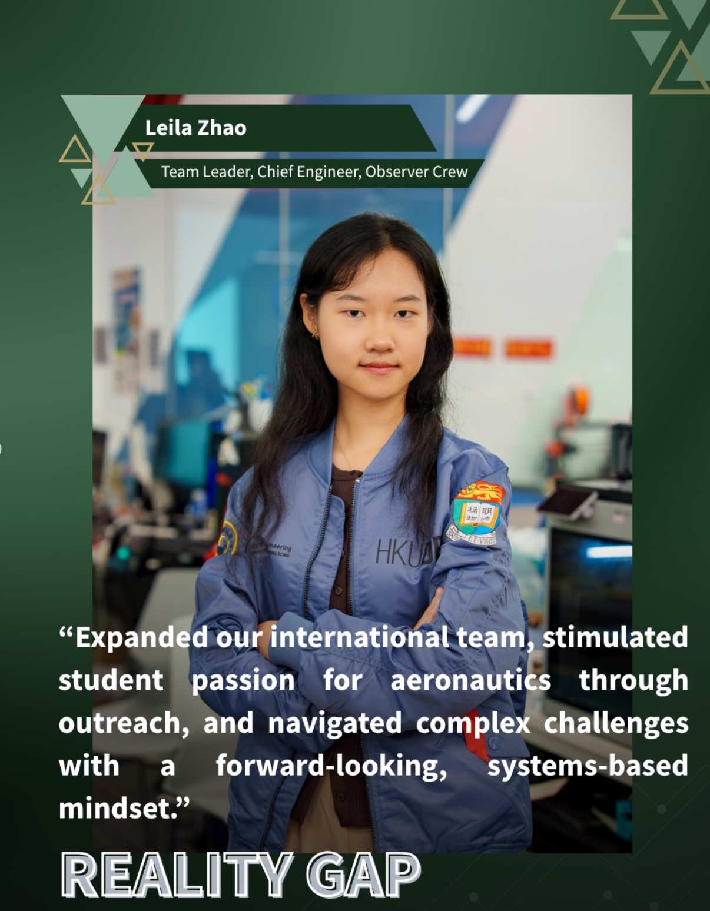

# Leila Zhao

## Mechanical Engineering Student at the University of Hong Kong | Aspiring aerospace system engineer

### Passionate about aircraft designm UAV systems and future space exploration techonologies Passionate about aircraft design, UAV systems, flight testing and future space exploration technologies.

### About me 

Space exploration has been the driving force that motivated me to pursue engineering professionalism. Ever since I was small, I was drawn to mysteries that are still unknown to human. Space has captivated me since I was 7. 
My curiosity and persistence in knowing more about this world and the universe gave me the determination to explore and learn various engineering techniques. 
Inevitably, I have to face countless challenges, setbacks and uncertainties on my path to follow my passion, but I learnt to embrace and flourish the difficulties and turned them into my fuel. 
My passion in pursuing aerospace engineering will continue encouraging me to step out of my comfort zone, keep me in the path of knowledge and curiosity. [(more)](https://github.com/Leilazehui/Leilazehui.github.io/blob/main/about.md)

**Interested topics**

✈ Aerospace Systems Engineering

🚁 UAV Design & Control

🛰 Space Systems

🤖 Robotics & Autonomous Systems

[Project portfolio](https://github.com/Leilazehui/Leilazehui.github.io/blob/main/Assets/Project%20porfolio_Zhao%20Zehui%20_compressed%20(1).pdf) | [CV](https://github.com/Leilazehui/Leilazehui.github.io/blob/main/Assets/Zhao%20Zehui_CV_work.pdf)

  

Selecteed projects:
#### [Drone Control and Path Planning](https://github.com/Leilazehui/Leilazehui.github.io/tree/main/Project_%26_Competition/UAV%20Design%20and%20Control%20Drones)

#### [CanSat Satellite Design](https://github.com/Leilazehui/Leilazehui.github.io/blob/main/Project_%26_Competition/CANSAT%20Satellite%20Design.md)      **Role:** Software Lead

#### [AIAA DBF 2026 Competition](https://github.com/Leilazehui/Leilazehui.github.io/blob/main/Project_%26_Competition/DBF_AIAA.md)      **Role:** Team Leader, Chief Engineering, Aerodynamic Lead, Observer Crew

Research:

#### [Trade-space design framework and decision optimization for mission-driven aircraft design](https://github.com/Leilazehui/Trade-Space-Exploration-and-Decision-Framework-for-Mission-Driven-Aircraft-Design-/tree/main)       **Manuscript under preparation**

Work Experiences:
#### [Summer Intern in The Hong Kong and China Gas Company (Towngas), Jul 2024 - Aug 2024](https://github.com/Leilazehui/Leilazehui.github.io/blob/main/Work/towngas_intern.md) (Role: Summer Intern in residential product and quality department)

#### [WeGoAlgae, Jul 2024 - Dec 2024](https://github.com/Leilazehui/Leilazehui.github.io/blob/main/Work/WeGoAlgae.md) (Role: Mechanical and Electrical Engineer)

#### [Winter Intern: Student Technician in Feelings Group, Dec 2024 - Jan 2025](https://github.com/Leilazehui/Leilazehui.github.io/blob/main/Work/Student_Technician_Feelings_Group.md) (Role: Winter intern-Student Technican in Hardware Team)

#### [Part-Time Temporary Student Research Assistant in The University of Hong Kong, Sept - Nov 2025](https://github.com/Leilazehui/Leilazehui.github.io/blob/main/Work/SRA.md) (Role: Part-time student research assistant)

#### [Winter Intern in Hong Kong Productivity Council, Dec 2025 - Jan 2026](https://github.com/Leilazehui/Leilazehui.github.io/blob/main/Work/HKPC_Winter_Intern.md) (Role: Wintern Intern in Smart Manufacturing Division (Fashion and Textile Industry & Smart Machinery and Equipment))

Skills:

| CAD | Programming | System Engineering | Aerospace | 
|---------|-----------|-------------------| -------------|
| SolidWorks, AutoCAD, Ansys, Fusion360 | MATLAB, Python, C/C++ | Trade-space exploration, system architecture, requirement analysis, verification and validation | Aircraft design, UAV integration, mission analysis, flight testing |

