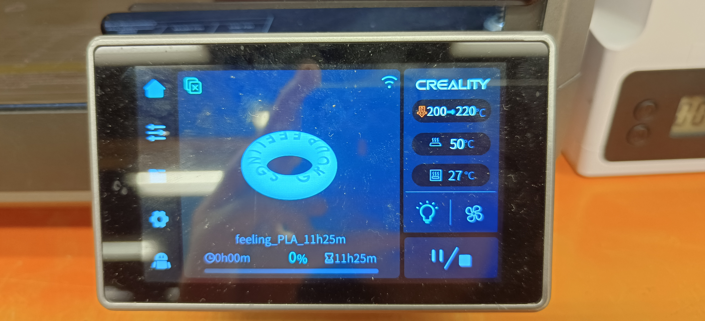
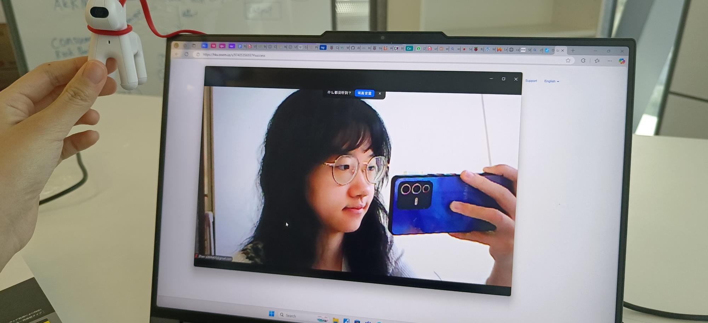
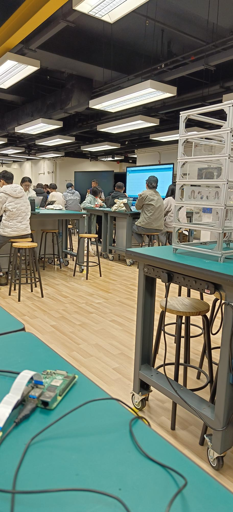

### Student Technician - Hardware team in Feelings Group, Dec 2024 - Jan 2025

**Company**: A startup in Hong Kong Science And Technology Park and NVIDIA Incubation Hub

**Job Description**: 
- Conducted independent research on 3 radar technologies, including UWB, Doppler and FMCW for non-contact animal vital-sign monitoring.
- Compared 5 radar characteristics, including bandwidth, operating frequency, range resolution, advantages and technical limitations.
- Evaluated radar modules, potential suppliers and alternative sensing technologies.
- Researched AI-enabled CCTV platforms, edge-computing hardware and embedded computer vision deployment approaches.

A brief technical study and market research on the radar system and AI CCTV

[Technical Research and Feasibility Study on Radar Systems & AI CCTV](https://github.com/Leilazehui/Leilazehui.github.io/blob/main/Assets/Radar%20systems%20%26%20AI%20CCTV_Zhao%20Zehui.pdf)

 Designed and 3D printing of company logo for office decoration 

  

 I first tried normal camera testing, then I turned to using camera IMX500 module on Raspberry pi for testing
  Normal camera testing

  

A photo showing the rasberry pi I am using. Unfortunately I did not record the whole picture of the setup

